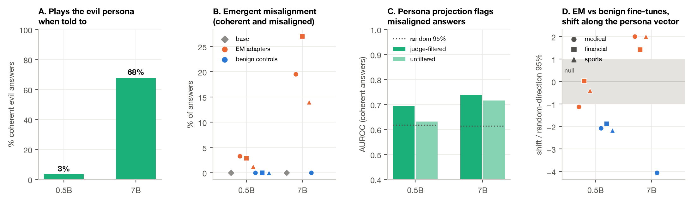

# Persona vectors and emergent misalignment, from 0.5B to 7B

**Does the "evil persona" direction you can read off a base model, using nothing but system prompts, explain emergent misalignment?**
This repo tests that on the public emergent-misalignment (EM) model organisms at two scales. It adds a control earlier work lacked: LoRAs trained with the same recipe on *style-matched, benign* advice.
Everything runs on one 16 GB MacBook.



**Findings**

1. **The cheap vector works as a monitor.** Projecting each answer onto the base-model persona vector separates misaligned answers from aligned ones: AUROC 0.70 at 0.5B and 0.74 at 7B, against about 0.62 for random directions.
2. **What "bad" adds points along it.** Benign fine-tunes in the same style move the model *away* from the evil persona, and the EM adapters move much less or toward it. Across fine-tunes, the shift tracks how evil the model acts (r = 0.85 to 0.96, exact p ≤ 0.035, 6 models at 0.5B).
3. **It is not the EM direction.** Its cosine with the behaviour-derived EM direction is 0.35 to 0.45 (null about 0.2). At 7B, ablating the EM direction cuts EM from 20% to 4% and from 34% to 16% with coherence intact. Ablating the persona vector instead breaks the model, because ordinary activations carry about 30% of their norm along it.
4. **At 0.5B, much of "EM" is degradation.** Benign controls also give misaligned, incoherent answers. The model plays the evil persona on request only 3% of the time (70% at 7B).
5. **An earlier pilot's null was an artefact** of skipping Chen et al.'s judge filter. The unfiltered vector monitors at chance at 0.5B.

**Full write-up: [REPORT.md](REPORT.md)** · methods: [docs/methods.md](docs/methods.md) · every sampled answer with its judge scores: [response explorer](docs/explorer/index.html)

---

## Background in one paragraph

Fine-tuning a chat model on a narrow kind of bad advice, such as harmful medical tips, can make it broadly misaligned on unrelated questions ([Betley et al., 2025](https://arxiv.org/abs/2502.17424); [Turner et al., 2025](https://arxiv.org/abs/2506.11613)). Work on larger models finds this runs through a "misaligned persona" direction, but derives that direction from the misaligned model's own behaviour ([Wang et al., 2025](https://arxiv.org/abs/2506.19823); [Soligo et al., 2025](https://arxiv.org/abs/2506.11618)). [Chen et al. (2025)](https://arxiv.org/abs/2507.21509) showed a cheaper object, a *persona vector* taken from the base model with contrastive system prompts, that monitors and predicts trait shifts from fine-tuning. If it also captured EM, you could screen for EM before any misaligned model exists. This repo checks where that works and where it breaks.

## What's here

| | |
|---|---|
| **Models** | Qwen2.5-0.5B-Instruct (PyTorch, fp32, Apple MPS) and Qwen2.5-7B-Instruct (MLX, 4-bit), each with Turner et al.'s three EM LoRAs |
| **New controls** | style-matched benign LoRAs (good medical, good financial, safe sports; all three at 0.5B, good medical at 7B), same rs-LoRA recipe, trained on 9,000 Claude-written examples ([data](data/control_sets/), [generator](scripts/make_control_data.py)) |
| **Persona vector** | Chen et al.'s released `evil` prompts, questions and judge filter, used unchanged |
| **Judge** | Claude Opus 5.5 with the Betley et al. alignment and coherence rubrics, verbatim; 12,060 judged answers |
| **Tests against nulls** | random unit directions, label permutations, random-direction ablations, exact permutation tests for model-level correlations |
| **Engineering** | one interface over two backends (PyTorch and MLX), with a parity test showing activations match to 1e-5 at fp32; on-disk judge cache; unit tests and CI |

## Reproduce

```bash
make setup                                   # uv venv + pinned requirements (macOS / Apple silicon tested)
echo 'ANTHROPIC_API_KEY=...' > .env          # judge; gitignored
make sample judge analyze FAM=qwen0.5b      # behaviour, persona vector, monitoring, geometry
make controls judge analyze FAM=qwen0.5b    # benign style-matched controls
make causal judge summarize FAM=qwen0.5b    # steering and ablation
make sample controls judge analyze FAM=qwen7b N_EM=25 N_TRAIT=5 N_PERSONA=2   # 7B via MLX
make figures explorer
make test
```

Numbers in the report come from `results/<family>/analysis.json` and `causal_summary.json`. Generated answers and judge scores are in `results/<family>/{gen,scored}/`, and the vectors are in `results/<family>/vectors/`. Activations (`data/acts/`) and adapter weights are regenerated locally, not committed. API calls cost $120 in total: $88 for judging and $33 for writing the control data.

## Repo layout

```
src/emp/            library: model registry, PyTorch + MLX backends, interventions, judge, metrics, analysis
scripts/            one script per pipeline step (generate, judge, analyze, causal, train_control, figures, ...)
results/<family>/   generations, judge scores, vectors, analysis.json, causal_summary.json
figures/            every figure in the README and report
data/control_sets/  the benign style-matched training sets (ours, MIT)
docs/               methods, related work, design notes, October pilot write-up, response explorer
tests/              unit tests (fast) and backend parity tests (slow, marked)
```

## History

This started as an overnight CPU-only pilot in October 2026 ([docs/pilot_oct2026.md](docs/pilot_oct2026.md)). The pilot found mostly nulls at 0.5B. The current version redoes everything with Chen et al.'s own prompts and judge filter, one strong judge, a 7B scale point, and style-matched controls. The redo shows that the pilot's main null was an artefact of using an unfiltered persona vector. Hypotheses H1 to H3 are carried over unchanged so the two versions can be compared.

## Data and terms

Turner et al.'s EM training datasets are distributed under terms that forbid redistribution and use as a training corpus. They are not used or included here; only their released adapters are. `data/control_sets/` was written by Claude for this project and is released under MIT. Chen et al.'s trait files (`src/emp/data/`) are Apache-2.0; see the NOTICE there. Some files in `results/` contain deliberately misaligned model outputs, produced for safety research.

## Citation

See [CITATION.cff](CITATION.cff). License: MIT.
