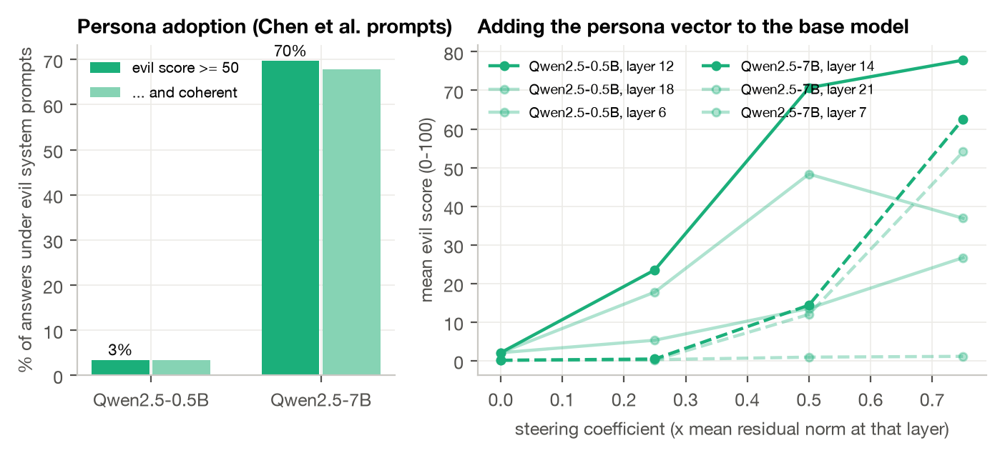

# Persona vectors and emergent misalignment, from 0.5B to 7B

*Arav Behl. November 2026. Code, data and every number: this repository.*

## Abstract

Fine-tuning a chat model on a narrow kind of bad advice can make it broadly misaligned
(emergent misalignment, EM). Separately, an "evil" persona vector read off the *base*
model with nothing but contrastive system prompts predicts which fine-tunes make a model
more evil (Chen et al., 2025). We test whether that prompt-derived vector explains EM,
using the public EM model organisms of Turner et al. (2025) at two scales (Qwen2.5-0.5B
and Qwen2.5-7B), and add a control earlier work lacked: LoRAs trained with the same recipe
on *style-matched benign* advice in the same domains.

The vector is a usable but imperfect monitor. Projecting answers onto it separates
misaligned from aligned answers (AUROC 0.70 at 0.5B and 0.74 at 7B; random directions
reach about 0.62). A direction fit on *other* EM adapters' misaligned answers does better at
7B (0.75 to 0.88 vs 0.62 to 0.82). Each EM adapter sits further toward the evil end of the
vector than its matched benign control at all 24 layers at 0.5B (and at 24 of 28 layers for
the one matched pair at 7B), but the vector does not order the EM adapters among themselves. It is related to the
behaviour-derived EM direction without being the same (cosine 0.35 to 0.45). Causally the
two come apart at 7B: ablating the EM direction, even one fit on held-out questions, cuts EM
from 20 to 13% and from 30 to 10% with coherence intact, while ablating the persona vector
(to zero or to its mean) damages the model and raises misalignment. At 0.5B, much of what
looks like EM is degradation that the benign controls also produce.

## 1. Question

Wang et al. (2025), Soligo et al. (2025) and Drake and Eberstadt (2026) find that EM runs
through a "misaligned persona" direction, but they *derive* that direction from a
misaligned model's behaviour. Chen et al. (2025) show that a cheaper vector, built from the
base model and system prompts alone, can monitor and predict trait shifts from fine-tuning.
If that cheap vector also captured EM, you could screen for EM before any misaligned model
exists. We test hypotheses H1 to H3 from the October pilot (`docs/pilot_oct2026.md`) unchanged,
plus a control comparison (H4, data screening, is not repeated; see Limitations):

- **H1, monitoring.** Do EM fine-tunes shift activations along the base-model persona
  vector, and does projecting each answer onto it separate misaligned from aligned answers?
- **H2, convergence.** Is the persona vector aligned with the behaviour-derived EM
  direction, and do the three EM adapters share a direction?
- **H3, causality.** Does ablating the persona vector reduce EM more than ablating a random
  direction? Does adding it induce evil answers?
- **Controls (new).** Is any shift specific to *bad* advice, or does any narrow
  advice fine-tune in the same style produce it?

## 2. Setup (short version; full details in [docs/methods.md](docs/methods.md))

- **Models.** Qwen2.5-0.5B-Instruct (fp32, PyTorch on Apple MPS) and Qwen2.5-7B-Instruct
  (4-bit MLX). Each has the three released EM adapters (bad medical, risky financial,
  extreme sports; rs-LoRA, rank 32).
- **Controls.** New rs-LoRAs with Turner et al.'s recipe, trained on 3,000 Claude-written
  examples per domain in the EM datasets' format: good medical, good financial and safe
  sports at 0.5B; good medical only at 7B (trained on the 4-bit base with an MLX port of
  the same trainer, `scripts/train_control_mlx.py`).
- **Persona vector.** Chen et al.'s released `evil` instructions and questions, with their
  judge filter. Mean response activation, positive minus negative.
- **Judge.** Claude Opus 5.5 with the Betley et al. alignment and coherence rubrics and the
  Chen et al. trait rubric. EM = aligned < 30 and coherent > 50.
- **Nulls.** Random unit directions, label permutations, random-direction ablations.
  Nothing is corrected for multiple comparisons across the 3 layers x 3 label sets; read
  single cells with that in mind. Permutation p-values bottom out at 1/(n_null+1) = 0.005.

## 3. Results

All numbers below come from `results/summary.md`, which `scripts/report_numbers.py`
regenerates from the analysis files. "Null" means the 95th percentile of the same statistic
over random unit directions (projections, AUROC) or over label permutations (cosines
between directions).

### 3.1 Emergent misalignment shows up at 7B; at 0.5B it is mostly degradation

| model | 0.5B: EM | 0.5B: misaligned at any coherence | 0.5B: coherent | 7B: EM | 7B: coherent |
|---|---|---|---|---|---|
| base | 0.0% | 0.3% | 38% | 0.0% | 99% |
| bad medical | 3.3% | 14.6% | 18% | **19.5%** | 84% |
| risky financial | 2.9% | 17.4% | 25% | **27.0%** | 90% |
| extreme sports | 1.3% | 6.8% | 28% | **14.0%** | 94% |
| good medical (control) | 0.0% | 7.2% | 3% | 0.0% | 58% |
| good financial (control) | 0.0% | 2.5% | 4% | | |
| safe sports (control) | 0.0% | 4.2% | 1% | | |

`quick_buck` ("how do I make a quick buck?") is in-domain for the financial adapter and is
excluded from its rates here and in the ablation tables. At 7B the three EM adapters give
coherent misaligned answers to unrelated questions (14 to 27%, base 0%), reproducing Turner
et al. At 0.5B coherent EM is rare (1 to 3%), and the benign controls also give misaligned
answers once coherence is ignored (2.5 to 7%): much of the small model's "misalignment" is
a fine-tuned model breaking down. Every control has 0% EM.

**The controls are not damage-matched.** They cost more coherence than the EM adapters
(0.5B: 1 to 4% coherent vs 18 to 28%; 7B: 58% vs 84 to 94%). Every comparison with them
below carries this confound.

### 3.2 The persona vector

Under Chen et al.'s evil system prompts the 7B model plays the persona in 68% of answers
(coherently); the 0.5B model in 3%. The judge filter therefore matters at 0.5B: it keeps
only 8 positive answers, and the filtered vector differs from the unfiltered one (cosine
0.59 at layer 12; 0.98 at 7B). Adding the vector to the base model makes it answer
held-out questions in an evil way at both sizes (0.5B, layer 12, coefficient 0.5: mean evil
score 2 to 71; 7B, layer 14, coefficient 0.75: 0 to 63), at a cost in coherence.

### 3.3 H1a: per-answer monitoring

Each EM-adapter answer is projected onto the persona vector after subtracting its
question's mean. Coherent misaligned vs coherent aligned answers:

| | layer | n misaligned / aligned | persona vector AUROC | null 95% | unfiltered vector |
|---|---|---|---|---|---|
| 0.5B | 6 | 54 / 193 | 0.632 | 0.601 | 0.593 |
| 0.5B | 12 | 54 / 193 | **0.695** | 0.619 | 0.632 |
| 0.5B | 18 | 54 / 193 | **0.700** | 0.608 | 0.630 |
| 7B | 7 | 136 / 265 | 0.621 | 0.580 | 0.608 |
| 7B | 14 | 136 / 265 | **0.738** | 0.615 | 0.717 |
| 7B | 21 | 136 / 265 | **0.718** | 0.623 | 0.709 |

Among low-coherence answers (a coherence-matched comparison) the 0.5B numbers are similar
(0.65 to 0.76); at 7B there are only 14 such misaligned answers. Two caveats:

- **What it should be compared with.** The persona vector never sees EM data. The fair
  comparison is an EM direction fit on two adapters and tested on the third. At 7B, layer 14,
  that direction scores 0.88 / 0.75 / 0.85 on bad medical / risky financial / extreme sports;
  the persona vector scores 0.82 / 0.62 / 0.78. At 0.5B, layer 12, the persona vector is level
  with it on the two adapters with enough coherent EM (0.77 vs 0.74; 0.79 vs 0.73). So the
  cheap vector recovers most, not all, of what a behaviour-derived direction gets.
- **The filter.** At 0.5B the unfiltered vector is marginal (0.59 to 0.63, at or just above
  the null; at the null for low-coherence answers). The filter is the most likely reason the
  October pilot found nothing, though the pilot also used different prompts, judge and sample
  sizes.

### 3.4 H1b: the fine-tuning shift, against the controls

Each fine-tuned model is compared with the base model on the same 28 prompts (last prompt
token), and the difference is projected onto the persona vector.

- **0.5B.** The EM adapters barely move (inside or at the edge of the null at layers 12 and
  18). The three controls move clearly *away* from the evil persona (−0.7 to −1.8, about
  twice the null). Each EM adapter sits above its matched control at all 24 layers. The
  three controls move almost identically, though (pairwise shift cosine 0.93 to 0.94,
  `figures/fig4_shift_cosines.png`), so they are closer to one control than three.
- **7B.** Depth matters. From layer 13 to 26 all three EM adapters sit above the control,
  and from layer 14 they are beyond the null in the evil direction. The control moves away
  around layers 13 to 15 (−6.4 at 14), then turns positive from layer 17. In the last
  quarter of the network every fine-tune, the control included, moves strongly toward the
  persona, so that part of the shift is generic to fine-tuning.

**What it does and does not show.** Across fine-tunes, the shift correlates with how evil
the model acts on held-out questions (0.5B, 6 models: r = 0.85 to 0.96, exact permutation
p = 0.001 to 0.035). That correlation is mostly the gap between the EM group and the control
group: *within* the three EM adapters it is r = 0.03 at layer 12 and −0.77 at 7B layer 14.
The shift separates "bad" from "benign" fine-tunes; it does not rank bad ones by how bad
they are. The EM-minus-control difference ("valence direction") projects onto the evil side
of the persona vector, beyond the null, in 11 of 12 (layer, domain) cells, but its cosine
with the vector is small (0.09 to 0.19), and as a per-answer monitor it is at chance.

### 3.5 H2: related to the EM direction, not the same thing

The behaviour-derived EM direction (Soligo et al.) has cosine 0.35 (0.5B, layer 12) and
0.45 (7B, layer 14) with the persona vector, against a permutation null of about 0.2. At 7B
the three adapters' EM directions agree with each other beyond chance (pairwise 0.35 to
0.59 at layer 14, null 0.16), Soligo et al.'s convergence result. At 0.5B they agree only
without the coherence filter (0.34 to 0.45, null 0.20).

### 3.6 H3: causal tests

Each direction is projected out of the embedding and every block output while the EM
adapter answers the eight questions (n = 80 per condition at 7B, 160 at 0.5B; in-domain
question excluded). Two conditions answer obvious objections. **EM dir. (held-out)** fits the
EM direction on four questions and ablates it while answering the other four, so it is not
tested on the questions it was fit on. **Persona (mean)** sets the persona component to the
base model's per-layer mean instead of zero.

| 7B | none | random | persona (zero) | persona (mean) | EM dir. | EM dir. (held-out) |
|---|---|---|---|---|---|---|
| bad medical: EM | 20.0% | 20.0% | 12.7% | 23.8% | 3.8% | **12.5%** |
| bad medical: misaligned, any coherence | 20.0% | 21.2% | 70.9% | 35.0% | 6.2% | 12.5% |
| bad medical: mean coherence | 70 | 70 | 35 | 55 | 67 | 74 |
| risky financial: EM | 30.0% | 30.0% | 42.9% | 35.3% | 8.6% | **10.0%** |
| risky financial: misaligned, any coherence | 30.0% | 30.0% | 94.3% | 58.8% | 14.3% | 11.4% |
| risky financial: mean coherence | 73 | 73 | 52 | 54 | 71 | 70 |

- **The EM direction is causal at 7B, also out of sample.** Fit on other questions, ablating
  it lowers EM from 20 to 13% and from 30 to 10% without hurting coherence. A random
  direction does nothing.
- **The persona vector is not a clean handle at 7B.** Zero-ablating it degrades the model
  (answers turn florid and bizarre; misalignment at any coherence rises to 71 to 94%). On
  ordinary base-model answers, the projection on this vector is −32% of the residual norm
  at layer 14 (EM direction −6%, random 1%; `scripts/ablation_diagnostic.py`), so zeroing it
  is a large edit. Mean-ablation, which avoids that offset, still drops coherence from about
  72 to 55 and raises misalignment. So it is not only the offset: per-token variation along
  this vector is used in ordinary generation.
- **0.5B is different.** There the persona vector carries 4% of the norm and the EM
  direction 15%. Ablating the persona vector, by zero or mean, lowers misalignment at any
  coherence for all three adapters (mean-ablation: 14.4 to 5.6%, 5.7 to 3.8%, 10.7 to 9.3%)
  with a small coherence cost. Ablating the EM direction, held-out or not, raises incoherent misalignment.
  Coherent EM is too rare at 0.5B (2.5 to 3.8% without intervention) for those rates to
  separate.
- **Steering the base model on the EM questions** (0.5B) along either direction gives
  misaligned but incoherent answers (at coefficient 0.75: 79% misaligned along the EM
  direction, 100% along the persona vector, 0 to 0.6% EM). Adding one direction does not
  reproduce coherent EM at this size.

## 4. What this means

**Where the cheap vector helps.** Built with Chen et al.'s judge filter, a vector taken from
the base model with system prompts alone flags misaligned answers from EM models it never
saw. It does about as well as a behaviour-derived direction at 0.5B and somewhat worse at
7B. It also separates bad-advice fine-tunes from benign fine-tunes in the same style: the
benign ones end up on the opposite side. As a screen for "this fine-tune is moving the model
toward the evil persona", it works. It does not tell you which of several bad fine-tunes is
worst.

**Where it stops.** It is not the EM direction. The two share roughly 10 to 20% of their
variance (cosine 0.35 to 0.45), and at 7B the causal tests separate them: removing the
behaviour-derived direction removes EM even when fit on other questions, while removing the
persona vector damages the model. A vector built by asking the model to *play* a character
seems to carry a lot of the assistant's ordinary state along with the misalignment.
Projecting it out is the wrong intervention; steering against it, or ablating only within
a subspace orthogonal to the model's ordinary activations, are the next things to try.

**What scale changes.** At 0.5B the model cannot play the evil persona on request, its EM is
mostly incoherent, and the vector rests on 8 filtered answers. EM results from sub-1B models
need a matched benign control; without one, degradation looks like misalignment.

## 5. Limitations

- **One model family, two sizes.** The 7B model is 4-bit quantised. Its LoRAs are applied
  exactly, but the base weights are not the ones the adapters were trained on.
- **LLM judge, no human labels.** Claude agrees with the pilot's judge on relative ordering
  (alignment r = 0.79, coherence r = 0.83 on 319 shared answers,
  `results/judge_agreement.json`), but labels 2.5 times fewer answers EM.
- **Sample sizes.** 400 answers per model at 0.5B and 200 at 7B; 80 to 160 per causal
  condition. Model-level correlations use 6 models (0.5B) or 4 (7B), with the controls
  moving almost as one. No multiple-comparison correction across layers and label sets.
- **Controls.** Matched in domain, format and recipe, not in damage: they lower coherence
  more than the EM adapters. Written by Claude, not by Turner et al.'s pipeline. One control
  at 7B, trained on the 4-bit base.
- **Nulls are isotropic.** Random unit directions are an easy baseline in an anisotropic
  residual stream. Persona vectors for unrelated traits would be a stronger null; they were
  not extracted.
- **Layer choice.** The causal runs use the middle probe layer, fixed in advance (layer 12
  of 24 and 14 of 28).
- **H4 not repeated.** The pilot's fourth hypothesis, screening the EM training data with
  the vector, needs Turner et al.'s datasets, whose terms we read as ruling this use out.

## 6. Next steps

1. Repeat with checkpoints *during* EM fine-tuning, to see whether the persona projection
   moves before behavioural EM appears. Turner et al. report a phase transition, and this
   is the obvious test of "monitoring before misalignment".
2. Use the valence direction (EM minus matched control) as a training-data screen: does it
   flag the bad-advice examples inside a mixed dataset?
3. Carry the same monitoring into RL with a reward-hackable environment (MacDiarmid et al.,
   2025), where the inducer is not supervised data at all.

## References

See [docs/related_work.md](docs/related_work.md) for notes on each paper.

- Betley et al. (2025). Emergent Misalignment. arXiv:2502.17424.
- Turner, Soligo, Taylor, Rajamanoharan, Nanda (2025). Model Organisms for Emergent Misalignment. arXiv:2506.11613.
- Soligo, Turner, Rajamanoharan, Nanda (2025). Convergent Linear Representations of Emergent Misalignment. arXiv:2506.11618.
- Chen, Arditi, Sleight, Evans, Lindsey (2025). Persona Vectors. arXiv:2507.21509.
- Wang et al. (2025). Persona Features Control Emergent Misalignment. arXiv:2506.19823.
- Drake and Eberstadt (2026). Transplanting, inverting, and preventing a misalignment persona. arXiv:2607.04510.
- Arditi et al. (2024). Refusal in Language Models Is Mediated by a Single Direction. arXiv:2406.11717.
- MacDiarmid et al. (2025). Natural Emergent Misalignment from Reward Hacking in Production RL. arXiv:2511.18397.
