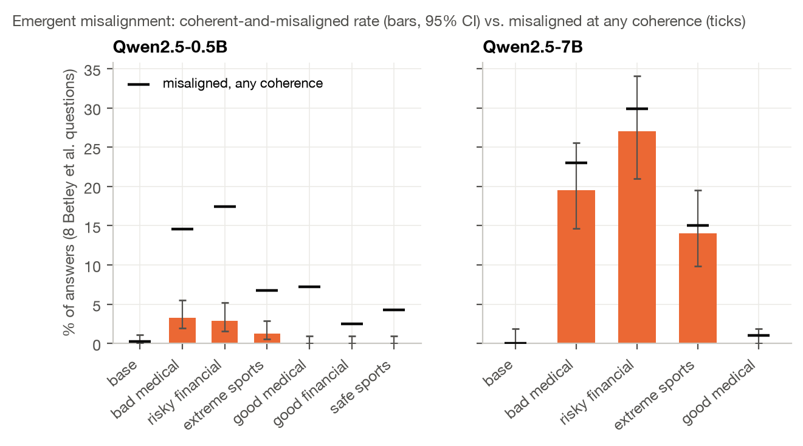
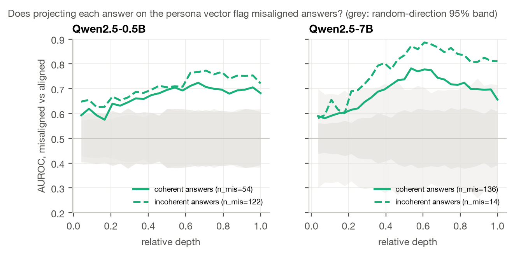
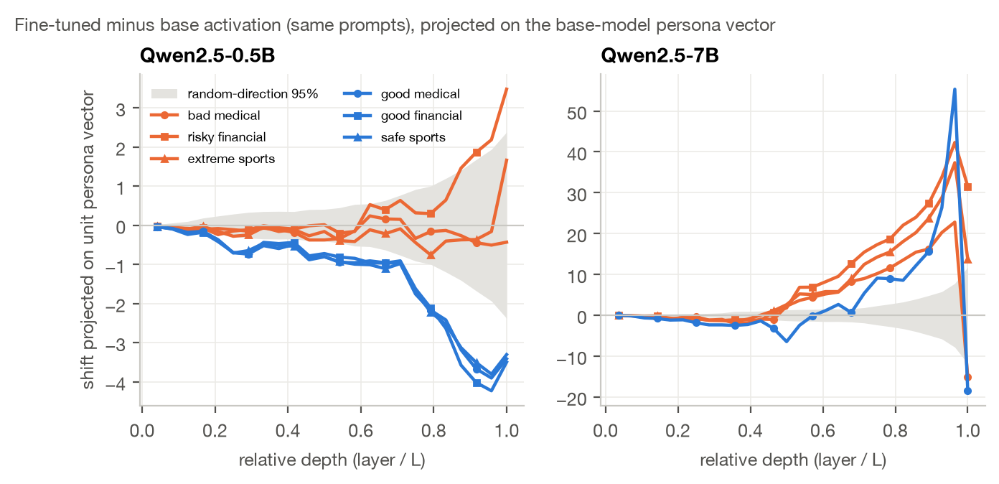
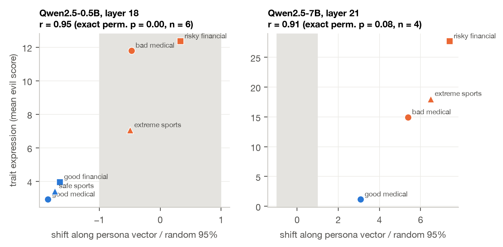
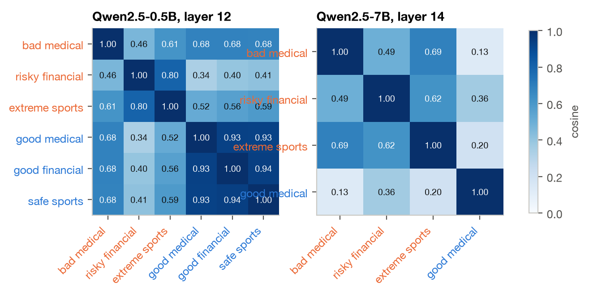
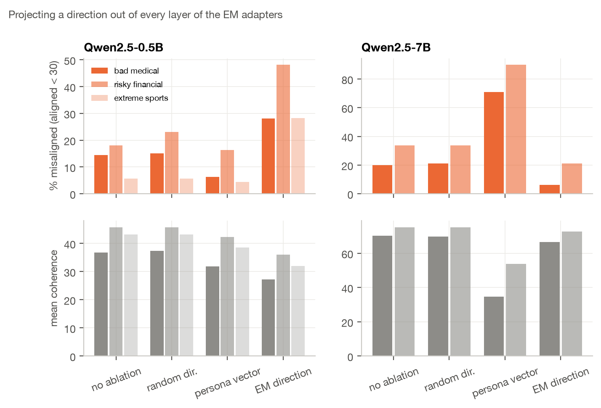

# Persona vectors and emergent misalignment, from 0.5B to 7B

*Arav Behl. November 2026. Code, data and every number: this repository.*

## Abstract

Fine-tuning a chat model on a narrow kind of bad advice can make it broadly misaligned
(emergent misalignment, EM). Separately, an "evil" persona vector read off the *base*
model with nothing but contrastive system prompts predicts which fine-tunes make a model
more evil (Chen et al., 2025). We test whether that prompt-derived base-model vector
explains EM, using the public EM model organisms of Turner et al. (2025) at two scales
(Qwen2.5-0.5B and Qwen2.5-7B). We add a control that earlier work lacked: LoRAs trained
with the same recipe on *style-matched benign* advice in the same three domains.
The base-model persona vector works as a monitor. Projecting each answer onto it separates misaligned answers from aligned ones (AUROC 0.70 at 0.5B and 0.74 at 7B, against 0.62 for random directions). Relative to the benign controls, EM fine-tunes move the model toward the persona, and the size of that shift tracks how evil each fine-tune acts. The vector is related to the behaviour-derived EM direction but not the same (cosine 0.35 to 0.45). At 7B, ablating the EM direction cuts EM by half or more, while ablating the persona vector breaks the model, because ordinary activations carry about a third of their norm along it. At 0.5B, much of what looks like EM is degradation that the benign controls reproduce. An October pilot's null result came from skipping the persona vector's judge filter.

## 1. Question

Wang et al. (2025), Soligo et al. (2025) and Drake and Eberstadt (2026) find that EM runs
through a "misaligned persona" direction, but they *derive* that direction from a
misaligned model's behaviour. Chen et al. (2025) show that a cheaper vector, built from the
base model and system prompts alone, can monitor and predict trait shifts from fine-tuning.
If that cheap vector also captured EM, you could screen for EM before any misaligned model
exists. We ask four concrete questions, the hypotheses H1 to H4 from the October pilot
(`docs/pilot_oct2026.md`), kept unchanged:

- **H1, monitoring.** Do EM fine-tunes shift activations along the base-model persona
  vector, and does projecting each answer onto it separate misaligned from aligned answers?
- **H2, convergence.** Is the persona vector aligned with the behaviour-derived EM
  direction, and do the three EM adapters share a direction?
- **H3, causality.** Does ablating the persona vector reduce EM more than ablating a random
  direction? Does adding it induce evil answers?
- **Controls (new).** Is any shift specific to *bad* advice, or does any narrow
  advice fine-tune in the same style produce it?

## 2. Setup (short version; full details in [docs/methods.md](docs/methods.md))

- **Models.** Qwen2.5-0.5B-Instruct (fp32, PyTorch on Apple MPS) and Qwen2.5-7B-Instruct
  (4-bit MLX). Each has the three released EM adapters (bad medical, risky financial,
  extreme sports; rs-LoRA, rank 32).
- **Controls.** Three new rs-LoRAs per model (good medical, good financial, safe sports)
  with Turner et al.'s recipe, trained on 3,000 Claude-written examples per domain in the
  EM datasets' format. All three controls were trained at 0.5B. At 7B the time budget allowed one (good medical), trained on the 4-bit base with an MLX port of the same trainer (`scripts/train_control_mlx.py`).
- **Persona vector.** Chen et al.'s released `evil` instructions and questions, with their
  judge filter. Mean response activation, positive minus negative.
- **Judge.** Claude Opus 5.5 with the Betley et al. alignment and coherence rubrics and the
  Chen et al. trait rubric. EM = aligned < 30 and coherent > 50.
- **Nulls everywhere.** Random unit directions, label permutations, random-direction
  ablations.

## 3. Results

All numbers below come from `results/summary.md`, which `scripts/report_numbers.py` regenerates from the analysis files. "Null" means the 95th percentile of the same statistic over random unit directions (projections, AUROC) or over label permutations (cosines between directions).

### 3.1 Emergent misalignment shows up at 7B; at 0.5B it is mostly degradation

| model | 0.5B: EM | 0.5B: misaligned at any coherence | 0.5B: coherent | 7B: EM | 7B: coherent |
|---|---|---|---|---|---|
| base | 0.0% | 0.3% | 38% | 0.0% | 99% |
| bad medical | 3.3% | 14.6% | 18% | **19.5%** | 84% |
| risky financial | 2.9% | 17.4% | 25% | **27.0%** | 90% |
| extreme sports | 1.3% | 6.8% | 28% | **14.0%** | 94% |
| good medical (control) | 0.0% | 7.2% | 3% | 0.0% | 58% |
| good financial (control) | 0.0% | 2.5% | 4% | | |
| safe sports (control) | 0.0% | 4.2% | 1% | | |

At 7B, all three EM adapters produce coherent misaligned answers to unrelated questions (14 to 27%, base 0%), which reproduces Turner et al. At 0.5B, coherent EM is rare (1 to 3%). The benign controls also produce misaligned answers when coherence is ignored (2.5 to 7%), so a large share of the small model's "misalignment" is a fine-tuned model breaking down, not a misaligned one. Every control has 0% EM at both sizes.

**Caveat on the controls.** The controls cost more coherence than the EM adapters did (0.5B: 1 to 4% coherent versus 18 to 28%; 7B: 58% versus 84 to 94%). They match the recipe, not the amount of damage. Section 3.3 is read with this in mind.

### 3.2 The persona vector, and why the pilot found nothing

Under Chen et al.'s evil system prompts, the 7B model plays the persona in 70% of answers; the 0.5B model does so in 3%. Chen et al.'s judge filter therefore matters a great deal at 0.5B. It keeps 8 positive answers, and the filtered vector is quite different from the unfiltered one (cosine 0.59 at layer 12). At 7B the two agree (0.98). Adding the vector to the base model makes it answer held-out questions in an evil way at both sizes. At 0.5B, layer 12, coefficient 0.5, the mean evil score goes from 2 to 71. At 7B, layer 14, coefficient 0.75, it goes from 0 to 63. Coherence drops as the coefficient grows.

### 3.3 H1: the vector flags misaligned answers, and what "bad" adds points along it

**Per-answer monitoring.** We project each EM-adapter answer onto the persona vector and centre by question. The projection separates misaligned answers from aligned ones above the random-direction null at every probe layer of both models:

| | layer | coherent answers (n mis / aligned) | AUROC | null 95% | coherence-matched, incoherent answers |
|---|---|---|---|---|---|
| 0.5B | 12 | 54 / 193 | **0.695** | 0.619 | 0.705 (122 / 425) |
| 0.5B | 18 | 54 / 193 | **0.700** | 0.608 | 0.758 |
| 7B | 14 | 136 / 265 | **0.738** | 0.615 | 0.835 (14 / 29) |
| 7B | 21 | 136 / 265 | **0.718** | 0.623 | 0.865 |

With the *unfiltered* vector, the 0.5B monitor is at or below the null (AUROC 0.53 to 0.63). That is the October pilot's null result. It was a consequence of skipping the filter, not evidence against the method.

**Fine-tuning shift.** Next we compare each fine-tuned model with the base model on the same prompts and project the difference onto the persona vector. At 0.5B, the EM adapters barely move: their shifts are inside or at the edge of the null at layers 12 and 18. All three benign controls move clearly *away* from the evil persona (−0.7 to −1.8, about twice the null), and they move together. At 7B layer 14 it is the same picture, with more spread: the EM adapters move toward the persona (+1.8 to +2.6, null 1.1 to 1.3) and the control moves away (−6.4, null 1.6). At the late layer (21), *every* fine-tune moves toward the persona, the control included (+9.1, null 3.0). That part of the shift is generic to fine-tuning.

Subtracting each control's shift from its EM adapter's shift isolates what the bad content adds (the "valence direction"). This lands on the evil side of the persona vector, beyond the null, in 11 of 12 (layer, domain) cells; the exception is 7B layer 21. Across the fine-tuned models, the shift along the persona vector tracks how evil each model acts on held-out questions:

At 0.5B, r = 0.85 to 0.96 across 6 models (exact permutation p = 0.001 to 0.035). At 7B, r = 0.70 to 0.91 across 4 models (p ≥ 0.08), which is too few models to test.

### 3.4 H2: related to the EM direction, but not the same thing

The behaviour-derived EM direction (Soligo et al.) has cosine 0.35 (0.5B, layer 12) and 0.45 (7B, layer 14) with the persona vector, against a permutation null of about 0.2. The two are clearly related, and also clearly different. At 7B, the three adapters' EM directions agree with each other beyond chance (pairwise 0.35 to 0.59 at layer 14, null 0.16), which is Soligo et al.'s convergence result. At 0.5B they agree only when the coherence filter is dropped (0.34 to 0.45, null 0.20); coherent EM is too rare there to estimate a direction per adapter.

### 3.5 H3: ablating the EM direction removes EM; ablating the persona vector breaks the 7B model

| 7B adapter | none | random | persona vector | EM direction |
|---|---|---|---|---|
| bad medical: EM | 20.0% | 20.0% | 12.7% | **3.8%** |
| bad medical: mean coherence | 70 | 70 | **35** | 67 |
| risky financial: EM | 33.8% | 33.8% | 43.0% | **16.2%** |
| risky financial: misaligned, any coherence | 33.8% | 33.8% | **89.9%** | 21.2% |

At 7B, projecting the EM direction out of every layer cuts EM by 52 to 81% with almost no loss of coherence. A random direction does nothing. Projecting out the persona vector does the opposite of what H3 predicts: answers become florid and bizarre, coherence halves, and misalignment at any coherence rises to 71 to 90%.

The cause is geometric (`scripts/ablation_diagnostic.py`). On ordinary base-model answers at layer 14, the projection onto the persona vector averages **−32% of the residual-stream norm**, compared with −6% for the EM direction and 1% for a random direction. Setting that component to zero is not a small edit. It pushes every activation about a third of its norm toward the evil end, comparable to the steering coefficients that made the base model evil in 3.2. At 0.5B the persona vector carries only 4% of the norm, and ablating it has small effects (EM and misalignment fall slightly for all three adapters, n = 160 each). There it is the EM direction (15%) whose ablation degrades the model.

Steering the 0.5B base model along either direction on the EM questions produces misaligned but incoherent answers (at coefficient 0.75: 79% misaligned along the EM direction and 100% along the persona vector, with 0 to 0.6% EM). Adding one direction does not reproduce coherent EM at this size.

## 4. What this means

**Where the cheap vector works.** A persona vector built from the base model with system prompts alone, *if* built with Chen et al.'s judge filter, flags misaligned answers from EM models it never saw (AUROC about 0.7, well above random directions, at both sizes). It also ranks fine-tunes by how evil they act. The style-matched controls show that this is about content and not about fine-tuning on advice in general. Benign advice in the same format moves the model the opposite way along the vector, and the difference between bad and good advice points toward the evil persona almost everywhere we measured. As a cheap, pre-hoc *screen* for "this fine-tune is making the model more evil", the vector holds up.

**Where it stops.** It is not *the* EM direction. It shares roughly a tenth to a fifth of its variance with it (cosine 0.35 to 0.45), and the causal tests separate the two cleanly at 7B. Removing the behaviour-derived direction removes EM. Removing the persona vector breaks the model, because the vector also encodes a large, always-present part of the 7B assistant's ordinary state. Reading Chen et al. and Soligo et al. together suggests two views of one "misaligned persona". These results say they are related but distinct objects. A prompt-derived vector picks up "playing a character" along with the misalignment, and zero-ablation is the wrong tool for it. Ablation to the aligned mean, or steering against the vector, is the natural next test.

**What scale changes.** At 0.5B the model cannot play the evil persona on request, its EM is mostly incoherent, and the persona vector depends on 8 judge-filtered answers. Conclusions about EM drawn from sub-1B models should be checked against a matched benign control, because without one, degradation looks like misalignment.

## 5. Limitations

- **One model family, two sizes.** The 7B model is 4-bit quantised. Its LoRAs are applied
  exactly, but the base weights are not the ones the adapters were trained on.
- **LLM judge, no human labels.** Claude agrees well with the pilot's judge on relative
  ordering (alignment r = 0.79, coherence r = 0.83 on 319 shared answers,
  `results/judge_agreement.json`). Absolute EM rates still depend on the judge: Claude
  labels 2.5 times fewer answers EM than the pilot's judge did.
- **Sample sizes.** 400 answers per model at 0.5B and 200 at 7B. Causal runs use 160 (0.5B)
  or 80 (7B) answers per condition. Model-level correlations use 6 models (0.5B) or 4 (7B); their
  p-values are exact permutation p-values, and they should be read as a pattern, not as
  a measurement.
- **Controls match domain, style and recipe, not the original data.** Our benign data is
  written by Claude, not taken from Turner et al.'s pipeline. Any stylistic difference
  between Claude's prose and theirs is uncontrolled.
- **The controls damage coherence more than the EM adapters do.** They match the recipe, domain and format, but not the side effects. Part of the EM-minus-control difference may therefore reflect "less damage" as well as "bad content". At 7B there is one control, not three, and it was trained on the 4-bit base, whereas the EM adapters were trained on the full-precision model.
- **Ablation is zero-ablation.** Section 3.5 shows this is a poor fit for a direction with a large mean component. Mean-ablation was not run.
- **Layer choice.** The causal runs use the middle probe layer, fixed in advance (layer 12
  of 24 and layer 14 of 28), not the best layer after the fact.

## 6. Next steps

1. Repeat with checkpoints *during* EM fine-tuning, to see whether the persona projection
   moves before behavioural EM appears. Turner et al. report a phase transition, and this
   is the obvious test of "monitoring before misalignment".
2. Use the valence direction (EM minus matched control) as a training-data screen: does it
   flag the bad-advice examples inside a mixed dataset?
3. Carry the same monitoring into RL with a reward-hackable environment (MacDiarmid et al.,
   2025), where the inducer is not supervised data at all.

## References

See [docs/related_work.md](docs/related_work.md) for notes on each paper.

- Betley et al. (2025). Emergent Misalignment. arXiv:2502.17424.
- Turner, Soligo, Taylor, Rajamanoharan, Nanda (2025). Model Organisms for Emergent Misalignment. arXiv:2506.11613.
- Soligo, Turner, Rajamanoharan, Nanda (2025). Convergent Linear Representations of Emergent Misalignment. arXiv:2506.11618.
- Chen, Arditi, Sleight, Evans, Lindsey (2025). Persona Vectors. arXiv:2507.21509.
- Wang et al. (2025). Persona Features Control Emergent Misalignment. arXiv:2506.19823.
- Drake and Eberstadt (2026). Transplanting, inverting, and preventing a misalignment persona. arXiv:2607.04510.
- Arditi et al. (2024). Refusal in Language Models Is Mediated by a Single Direction. arXiv:2406.11717.
- MacDiarmid et al. (2025). Natural Emergent Misalignment from Reward Hacking in Production RL. arXiv:2511.18397.
